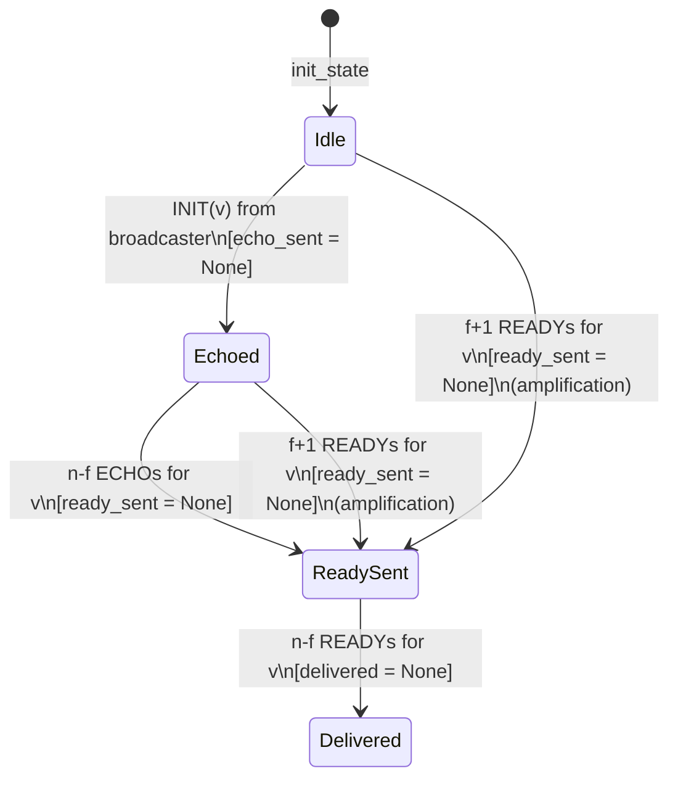

# Protocol Specification

## Message Types

Bracha's BRB uses exactly three message types. Each message carries:
- A broadcast instance identifier (isolates concurrent broadcasts)
- The proposed value (arbitrary bytes)
- An authenticated sender identity (from the channel, not the payload)

| Message | Fields | Purpose |
|---------|--------|---------|
| `INIT(v)` | instance, value | Broadcaster proposes value v |
| `ECHO(v)` | instance, value | Process acknowledges v |
| `READY(v)` | instance, value | Process signals sufficient support for v |

## Thresholds

For n total processes and f maximum Byzantine faults (with n > 3f):

| Threshold | Value | Trigger |
|-----------|-------|---------|
| Echo quorum | q = n − f | Enough ECHOs to send READY |
| Amplification | f + 1 | Enough READYs to amplify READY |
| Delivery | q = n − f | Enough READYs to deliver |

For n=4, f=1: q=3, amplify=2, deliver=3.
For n=7, f=2: q=5, amplify=3, deliver=5.

## Protocol Rules

### Rule 1: Echo

```
ON INIT(v) FROM broadcaster:
    if echo_sent is None:
        echo_sent = Some(v)
        broadcast ECHO(v)
```

A correct process echoes **exactly once**. Subsequent INIT messages are ignored.

### Rule 2: Ready

```
ON ECHO(v) FROM sender:
    echo_senders[v].insert(sender)      # deduplicate by sender identity
    if |echo_senders[v]| >= n-f AND ready_sent is None:
        ready_sent = Some(v)
        broadcast READY(v)

ON READY(v) FROM sender:
    ready_senders[v].insert(sender)     # deduplicate by sender identity
    if |ready_senders[v]| >= f+1 AND ready_sent is None:
        ready_sent = Some(v)
        broadcast READY(v)              # amplification
```

A correct process sends READY **at most once** per instance.

### Rule 3: Deliver

```
ON READY(v) FROM sender:
    ready_senders[v].insert(sender)
    if |ready_senders[v]| >= n-f AND delivered is None:
        delivered = Some(v)
        output DELIVER(v)
```

A correct process delivers **at most once** per instance.

> [!IMPORTANT]
> After every state mutation, all rules are re-evaluated. The protocol's correctness does not depend on message arrival order.

## Process State

```
ProcessState:
    echo_sent:    Option<Value>              # None → not yet echoed
    ready_sent:   Option<Value>              # None → not yet sent READY
    delivered:    Option<Value>              # None → not yet delivered
    
    echo_senders:  Map<Value, Set<ProcessId>>  # deduplication
    ready_senders: Map<Value, Set<ProcessId>>  # deduplication
```

**Why `Option<Value>` instead of `bool`?**

Using `Option<Value>` records *which* value the process committed to: not just whether it committed. This makes protocol violations immediately visible (a process committed to two different values) and makes the formal Coq model more informative.

## State Machine



## Deduplication Invariant

The sets `echo_senders[v]` and `ready_senders[v]` are `HashSet<ProcessId>`. Inserting the same sender twice is a no-op. This directly implements the requirement that counts must be based on **distinct authenticated process identities**, not raw message counts.

A Byzantine process sending 1000 duplicate ECHOs contributes at most 1 to the count.

## Why the Protocol is Correct

### Safety (Agreement)

Suppose two correct processes deliver values v and w. Each required n−f READY messages.

The two sets of READY senders each form a quorum (size ≥ n−f). Since both quorums are subsets of the n-process universe, their intersection has size ≥ 2(n−f) − n = n − 2f. Because n > 3f, we have n − 2f > f, so the intersection contains more than f processes: meaning at least one is **correct**.

A correct process sends READY for at most one value (READY Integrity). Therefore v = w.

### Liveness (Validity)

If the broadcaster is correct:
1. All correct processes receive INIT(v) → all echo v → n−f correct ECHOs circulate
2. All correct processes accumulate n−f ECHOs → all send READY(v)
3. All correct processes accumulate n−f READYs → all deliver v

This requires fair message delivery between correct processes.
